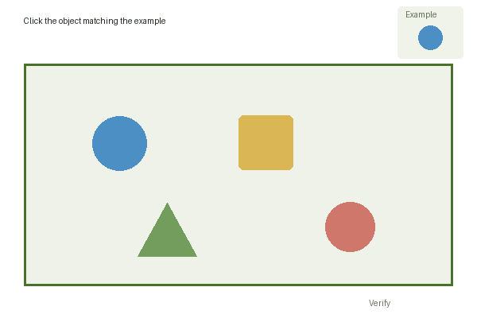

# Images, references and coordinates

The API needs both what the user sees and where interaction is allowed. All rectangles and returned points use the **full main screenshot**, not the browser window or a cropped canvas, as their coordinate system.



This is our own teaching illustration, not a real CAPTCHA. The main image is 600 × 400 pixels. The board starts at `(30, 80)` and spans `540 × 280` pixels. The blue circle at the top right is a reference; the blue circle on the board is a potential selection.

## Request fields

| Field | Type | Purpose |
| --- | --- | --- |
| `protocol` | String | Send `"1"`. |
| `challenge_id` | String | Your ID for this exact capture, 8–128 letters, digits, `_` or `-`. Use a new ID when the capture changes. |
| `question` | String | Exact visible instruction in its original language, 1–2,000 characters. |
| `image` | Base64 string | Full challenge screenshot including instruction, examples and interaction area. Static PNG/JPEG, no data URI prefix. |
| `references` | Array of Base64 strings | Separate crops of the small visual examples used for comparison. Up to nine. Empty or omitted if no reference exists. |
| `canvases` | Array of rectangles | Every clickable/draggable board, including a separate tray of movable pieces. At least one for point/drag challenges, at most eight. |
| `tiles` | Array of rectangles | Exactly nine separate DOM grid cells, left to right, top to bottom; otherwise empty or omitted. |

`references` contains images. `canvases` and `tiles` contain `{x, y, width, height}` objects. The singular field `reference` is rejected. A grid drawn inside a canvas uses that canvas's rectangle; do not invent nine DOM cells for it.

## Convert pixels to the 0–1000 scale

```text
x      = left_pixels   / image_width  × 1000
y      = top_pixels    / image_height × 1000
width  = width_pixels / image_width  × 1000
height = height_pixels / image_height × 1000
```

For our board:

```json
{ "x": 50, "y": 200, "width": 900, "height": 700 }
```

`x` and `y` identify the top-left corner. Width and height must be positive, and the rectangle must stay inside the image: `x + width <= 1000`, `y + height <= 1000`. Do not include the instruction, reference example or submit button in the interaction area.

If you control the DOM, measure the capture element and interaction elements with `getBoundingClientRect()` in the **same document/iframe**:

```javascript
function rectInCapture(element, captureElement) {
  const area = captureElement.getBoundingClientRect();
  const rect = element.getBoundingClientRect();
  if (!area.width || !area.height) throw new Error("Capture is not visible");
  return {
    x: (rect.left - area.left) / area.width * 1000,
    y: (rect.top - area.top) / area.height * 1000,
    width: rect.width / area.width * 1000,
    height: rect.height / area.height * 1000,
  };
}
```

The capture element must be exactly the region you screenshot. References are separate image files, so they do not change the main image's origin or size.

## Apply the answer

The server wraps actions inside `result.action`. Reject failed/cancelled operations, expired results, mismatched `challenge_id` values and captures that changed while the request ran. `id` is the server operation ID; it is not the capture ID.

| `action.type` | Payload example | Apply it |
| --- | --- | --- |
| `point` | `{"points": [[250, 450]]}` | Click each point, up to nine, in the returned order. |
| `grid` | `{"indices": [0, 4, 8]}` | Click the centers of those entries in your original nine `tiles`. Indices begin at zero. |
| `drag` | `{"moves": [{"source": [250,450], "target": [500,600]}]}` | Press at source, move to target and release; up to six moves. Always release on cancellation. |

For example, `[250,450]` is pixel `(150,180)` in the 600 × 400 image. To apply it in your browser, use the screenshot region's current box in **viewport CSS pixels**:

```javascript
function toViewport([x, y], captureBox) {
  return {
    x: captureBox.x + x / 1000 * captureBox.width,
    y: captureBox.y + y / 1000 * captureBox.height,
  };
}
```

Include the iframe's position in `captureBox` when needed. CSS dimensions may differ from PNG pixels; do not multiply the result by `devicePixelRatio` again. Confirm that the screenshot still matches the widget before applying the actions. Submit using the widget's button when required, wait for its feedback, and capture any new round again. Freehand drawing and rotation are not supported by this protocol.

Image mode returns actions, not a CAPTCHA token. The widget decides whether they are correct. A valid action response may consume credit even if the widget rejects it.
